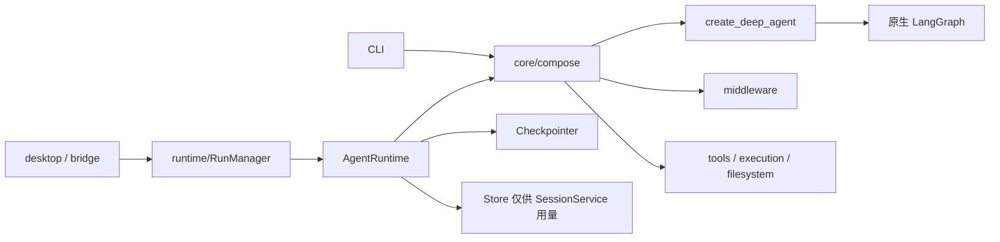
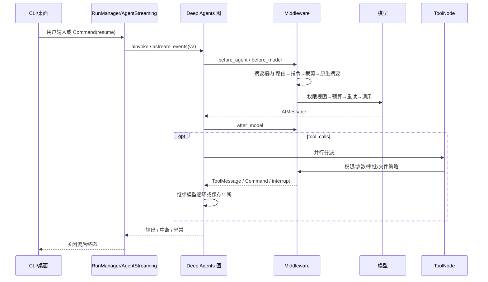
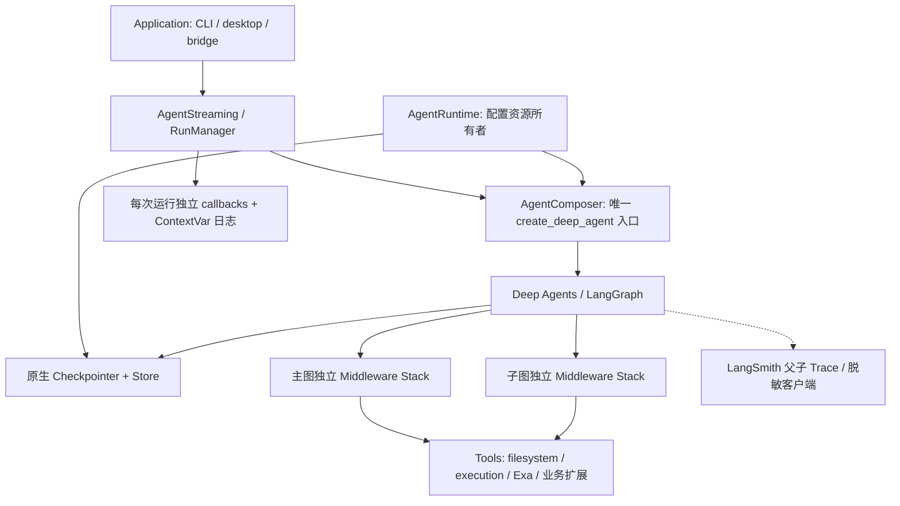
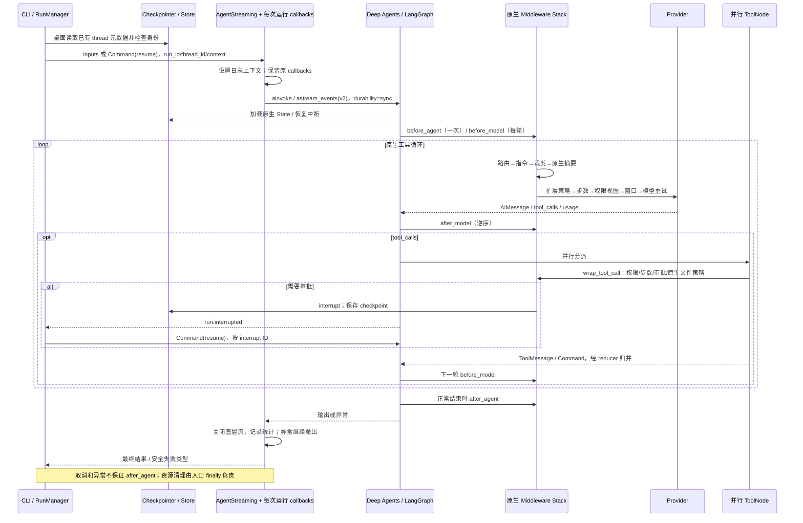

# Deep Agents 生产架构审计与重构

核验日期：2026-10-24。源代码与本地安装包实现为准；本文不修改生成的 OpenWiki。

## A. 实际基线

Windows / Python 3.12.11，修改前 `.venv/Scripts/python.exe -m pytest`：497 passed、10 skipped（46.50s）。完整输出：`.pytest_cache/deepagents-baseline.log`。跳过项依赖 Bun / 固定 OpenCode 检出或 Windows 符号链接权限，未调用付费模型。

现有能力：CLI、桌面 JSON-RPC、v2 事件流、原生 Deep Agents 工具循环、并行工具、general-purpose 委派、全局/项目 Skills 与 AGENTS.md、文档读取、原子文本修改/补丁、格式化、Shell/Python/后台作业、Exa、只读/审批/完全授权、动态双模型路由、旧工具结果裁剪、原生摘要与溢出恢复、流式断线续写、运行超时、步数限制、SQLite 检查点和用量。没有发现 MCP 客户端、RAG 服务或部署用的 HTTP/WebSocket/SSE 服务；不能声称这些能力已有回归。

### 重构前模块与执行链





### 真实技术债与处理决定

路径均相对 `packages/agent-harness/src/vertical_harness/`，测试在仓库 `tests/`。

| 问题位置 | 当前实现 | 架构缺陷 | 推荐方案 | 优先级 | 风险 |
|---|---|---|---|---|---|
| `core/compose.py:build_agent`、`runtime/agent_runtime.py:open_agent` | Runtime 打开 Store，但建图不传 `store=`；CLI 只打开 Checkpointer | ToolRuntime 无法使用已托管的跨线程 Store | 原生 `store=` 注入；同步/异步资源管理器负责关闭 | P1 | 不改 SQLite 表或用量 namespace |
| `core/compose.py:build_agent` | 主、子图传同一 middleware 列表和实例 | 将来在实例中增加可变字段会串扰；作用域隐含 | 使用已有装配方法分别创建栈 | P1 | 保留中间件名称与检查点键 |
| `middleware/filesystem.py`、`core/compose.py:_middleware` | 自定义实例名为 HarnessFilesystemMiddleware，未替换原生 FilesystemMiddleware | 同时注册两套文件工具与结果包装 | 工具实现按原生名称替换；目录指令迁入独立 Middleware，保留旧节点名称 | P1 | 重绑定工具时必须保留 apply_patch；不改变历史节点身份 |
| `core/compose.py:build_agent` | 工具列表和唯一子代理硬编码 | 新增业务 Tool 必须改核心入口 | 增量接收原生 Tool、Middleware、SubAgent、response_format | P1 | 不增加 Registry 或调度器 |
| `langchain/callbacks.py`、`langchain/streaming.py` | WorkflowLoggingHandler 已实现但生产入口未注册；log_context 也未绑定 | 实际运行缺少请求关联和耗时统计 | 每次调用创建独立 callback，复用框架父子 run 树 | P1 | 不能把 callback 绑定成共享图级计数器 |
| `middleware/model_retry.py` | 自定义指数退避，不发 retry 指标；quota 判定在服务端强制重试提示之后 | 无法审计真实重试；欠费可能重复请求 | 保留断流保护，结构化记录重试；quota 优先拒绝 | P1 | 只重试模型，不能包住 ToolNode |
| `config/langsmith_settings.py:create_client` | tracing 可选，但启用后使用默认 payload 上传 | 可能上传用户正文和工具内容 | 客户端隐藏 inputs；outputs/metadata/error 仅留白名单标识及数字用量；外层客户端由宿主管理 | P1 | 显式启用后仍需验证服务端访问控制与保留期 |
| `tools/search.py:web_search` | 错误返回普通 str | 工具错误率统计为成功 | 使用 ToolException 和框架 handle_tool_error，保留可读错误文本 | P2 | 正常来源输出不变 |
| `runtime/session_service.py`、`runtime/run_manager.py` | 审批恢复校验身份，快照/新轮次/删除未校验已存在检查点所有者 | 同一持久化库换身份后可接触其他身份的 thread | 在应用会话边界核对现有 checkpoint metadata | P1 | 无历史身份元数据的 CLI 检查点不能随意重新归属 |
| `middleware/summarization.py` | 在原生固定摘要槽内调用 prepare/aprepare | 存在跨关注点依赖，但直接平铺会让摘要先于路由和指令执行 | 保留必要适配；原生机制负责压缩，不另造 loop/AOP 引擎 | P2 | `test_model_context.py` 覆盖时序与检查点索引 |
| `middleware/approval.py` | 自定义 per-call interrupt | 与官方 HITL 相似，但桌面要求 kind/action_requests/decisions 及旧暂停检查点 | 保留薄协议适配；中断、调度、恢复全用 LangGraph | P2 | 直接换 native HITL 会改变载荷及恢复位置，不属于安全的内部重构 |
| `storage/store.py`、`storage/checkpoint.py` | create_* 与 open_* 两类资源接口 | create_* 调用者承担连接关闭，易误用 | 生产入口统一 open_*；保留公共 create_* 契约及现有测试 | P2 | 本轮不无依据删除对外类方法 |

AST 依赖检查已有 `test_backend_boundaries.py`、`test_class_structure.py`。没有发现生产 AgentExecutor、旧 Chain、第二套模型循环或 MCP 全局单例；不虚构需要删除的旧系统。

## B. 目标与技术选择

PyPI JSON 实时核实并通过 uv 更新锁：Deep Agents 0.7.28→0.7.32，LangChain 1.4.6→1.4.7，langchain-core 1.6.12→1.7.0，LangGraph 1.2.16→1.2.17，LangSmith 0.14.11→0.14.12。Checkpoint 4.3.0、SQLite 3.1.2 不变。Pydantic v2、Python >=3.11 沿用工程边界，本机用 3.12；不新加框架。`uv.lock` 为完整可复现版本依据。

依据：[Deep Agents 定制](https://docs.langchain.com/oss/python/deepagents/customization)、[Middleware Hook 顺序](https://docs.langchain.com/oss/python/langchain/middleware/custom)、[官方预置策略](https://docs.langchain.com/oss/python/langchain/middleware/built-in)，以及 `.venv/Lib/site-packages/deepagents/graph.py`、`langchain/agents/factory.py` 的实际实现。

参考图的修正：before hook 正序、after hook 逆序、wrap 第一个在最外层；Deep Agents 的原生槽位按 `.name` 替换而非任意平铺。`after_agent` 不是 finally；失败、取消、持久化失败由应用入口传播和清理。本地 wrap_tool_call 看不到 Provider 内部工具。官方 HITL 有 batched/per_call 模式，均与当前桌面中断协议不同。没有业务需求支持 Beta Profiles/Dynamic Subagents/Event streaming，继续稳定的 v2 事件协议。



迁移原则：保留现有目录，减少缺失的依赖连线和共享实例；不重命名模块制造重构规模。所有步骤先运行相关回归，最后全量 pytest、Ruff、全包 mypy、桌面契约及构建。

## C. 实施及最终验证

### 目录与迁移映射

不搬迁已有业务目录，不创建第二套 Agent Harness。

```text
重构前                                 重构后
core/compose.py                        core/compose.py（统一原生扩展入口与 Store 注入）
middleware/filesystem.py               middleware/filesystem.py（只负责文件工具）
  └ 文件工具 + 目录指令                middleware/directory_instructions.py（迁入目录指令）
config/langsmith_settings.py           config/langsmith_settings.py
                                      config/trace_redaction.py（上传脱敏策略）
langchain/{streaming,callbacks}.py      原位接通运行观测，不另建审计总线
runtime/{run_manager,session_service}   原位加入已存在检查点的身份检查
storage/{checkpoint,store}.py          原生实现与 SQLite 格式不变
tools/search.py                        原位分离执行方法和 StructuredTool 定义
tests/                                新增图集成与观测测试，更新真实 SQLite fixture
docs/                                 DEEP_AGENTS_REFACTOR.md（本报告）
```

新增两个生产类均对应具体职责：目录指令从文件工具中迁出，TraceRedaction 处理上传边界。不增加 Registry、全局 Manager、DI 容器、业务基类、兼容模块或 AOP 引擎。

### Middleware 实际注册顺序与 Hook 矩阵

主图的有效顺序为：

1. `FilesystemMiddleware`：由 HarnessFilesystemMiddleware 按 `.name` 替换，**只有一层**；完整传入 backend、permissions 和工具配置。
2. 原生 `SubAgentMiddleware` 与父子通知组件。
3. `SummarizationMiddleware`：由 HarnessSummarizationMiddleware 按名替换，只有一层。
4. 原生 `PatchToolCallsMiddleware`。
5. 可选 `TodoListMiddleware` → 调用者显式扩展 → `ExecutionLimitsMiddleware` → `DesktopPermissionMiddleware` → `ContextLimitMiddleware` → `ModelRetryMiddleware` → ask 模式下的 `DesktopApprovalMiddleware` → `DirectoryInstructionsMiddleware`。
6. 框架根据模型装配的尾部策略：profile extras、可选 Skills、原生 prompt caching、UnsupportedContent。宿主没有重复加入这些能力，也没有启用 Beta Profile 注册机制。

DirectoryInstructionsMiddleware 的 `.name` 固定为 `HarnessFilesystemMiddleware`，这是已有检查点节点 `HarnessFilesystemMiddleware.before_model` 的身份；不是运行两套文件实现。权限重绑定重新创建工具时，`_create_tools` 同时注册 apply_patch，避免原生复制步骤丢失补丁工具。

| 组件 / 源文件 | Hook / 输入输出 | State 修改 | 异步 / 幂等 / 并发 / 错误 |
|---|---|---|---|
| `filesystem.py` | 原生 wrap_model_call / wrap_tool_call；工具返回 ToolMessage 或 Command | 继承框架文件/媒体状态契约 | I/O 异步适配；原子写和路径权限沿用；不重试写操作 |
| 原生 `SubAgentMiddleware` | task 调度 → 独立子图 → ToolMessage/Command | 原生排除私有 State 字段并归并结果 | 调度、子图中断与恢复全由框架完成 |
| `summarization.py` | wrap_model_call：路由 prepare → 项目指令 prepare → 裁剪 prepare → 原生摘要 → handler | 原生 ExtendedModelResponse/Command 更新摘要事件；完整历史保留 | 同步/异步对应；参数配置只读；不在实例保存摘要计数 |
| `routing.py` | 被摘要位置调用 prepare/aprepare；返回 request.override(model=...) | 无 | 不修改共享模型配置；路由依据可信 RunContext.task_tier |
| `project_instructions.py` | prepare/aprepare 构造当前请求 system_message | 无 | 每次读取指令，不将私密正文写日志 |
| `context_pruning.py` | prepare/aprepare 生成压缩后的请求视图 | 不覆盖 checkpoint 原消息 | 旧结果完整归档；最近结果不裁剪；I/O 失败传播 |
| 原生 TodoList | 注册 write_todos，规划提示随请求加入 | 原生 todos reducer | 默认保留；关闭规划时不注册 |
| `execution_limits.py` | before_model、wrap_model_call、after_model、wrap_tool_call | 仅增量 messages / jump_to；步数从消息计算 | 无共享计数器；超限禁止工具，长度截断最多续写两次 |
| `permission.py` | wrap_model_call 隐藏禁用工具；wrap_tool_call 再次检查 | 无 | 同步/异步；PermissionError 传播；只读禁用委派与执行 |
| `context_limit.py` | wrap_model_call 检查最终请求窗口 | 无 | 按当前 request.model 容量估算；ContextOverflowError 进入原生摘要恢复 |
| `model_retry.py` | wrap_model_call + after_model | 部分文本携带既有重试标记；after_model 插入续写消息 / jump_to=model | 最多 10 次重试、3 次超时重试；尊重 Retry-After；欠费不可重试；取消/GraphBubbleUp 不捕获；计数在调用局部或消息中 |
| `approval.py` | wrap_tool_call：原生 interrupt 后继续 handler 或拒绝 ToolMessage | 仅原生 interrupt checkpoint | 不重试工具；approve/reject 协议保留；扩展副作用工具用 metadata.requires_approval 标记 |
| `directory_instructions.py` | before_model：从成功 read_file 结果定位目录指令 | 返回增量 HumanMessage，沿用已有标记键 | async to_thread；根据已持久消息去重；权限检查后读取；仅忽略可预期路径/I/O 失败 |
| 原生 Skills / caching / Patch | before_agent、before_model、wrap 等由框架定义 | 原生技能索引及消息修复 | 不复制实现、不改变其状态键 |
| `langchain/callbacks.py` | callbacks 观测完整模型、工具、链与子图树 | 无 | 每个 AgentStreaming 调用独立实例；锁保护并行 callbacks；错误只记录类型和耗时 |
| 扩展 Middleware | 原生 before_agent / before_model / wrap / after_model / after_agent | 按 schema/reducer 返回更新 | 主图扩展不隐式继承给子图；每个 SubAgent 声明显式扩展 |

before hooks 正序、after hooks 逆序、wrap 外进内出。after_model 的输入始终是模型结果更新后的 State，ToolMessage 经 ToolNode/reducer 写回后进入下一轮模型；没有把工具结果直接喂给 after_model。每个声明式子代理分别调用同一装配方法得到新策略实例；共享的后端/模型只是基础设施资源，不保存请求计数。项目的动态路由是全局策略，配置双模型时也作用于子代理。



### State / Context / Persistence

| 机制 | 本项目契约 | 持久化 / 隔离 |
|---|---|---|
| State | 显式使用官方 DeepAgentState，框架合并 Middleware Schema；没有可计算业务统计的副本 | messages 使用当前框架 DeltaChannel 消息 reducer（按消息 ID 合并）；todos、skills_metadata、摘要事件和媒体字段沿用官方状态 |
| Runtime Context | 冻结 RunContext(tenant_id, user_id, task_tier)，由宿主可信传入 | 不当作消息/检查点数据；不能让工具参数决定身份 |
| Checkpointer | 原生 SQLite / InMemorySaver，thread_id 标识一个消息历史 | thread_id 在单个数据库内唯一；桌面 metadata 保留 desktop_tenant_id/user_id/run_id，用于访问及审批恢复检查 |
| Store | 原生 BaseStore 注入 create_deep_agent(store=...)，供 ToolRuntime 使用 | SessionService 用量 namespace 不变；扩展业务数据必须包含 tenant/user 与业务用途，不能只按 thread_id 存放 |
| Filesystem Backend | DocumentFilesystemBackend + 全局 Skills CompositeBackend | 真实工作区与只读全局技能路由；文件权限不是进程沙箱；不将 Store 当作文件系统 |
| run_id | 每次执行关联 callbacks、Trace 与事件；审批恢复保持该轮桌面 run_id | 恢复执行使用新的 asyncio Task 身份，避免旧完成回调释放新任务 |

没有新增持久化业务字段或表，不需批量迁移。旧的合成消息标记是已存在数据契约，不是旧 LangChain API 兼容分支。目录指令节点身份保留，旧的工具审批中断载荷与 resume 位置保留。

桌面访问已有线程时身份不匹配或缺失将拒绝；**不自动认领无身份的历史检查点**。CLI 原有无身份检查点继续由 CLI 使用；若需要导入桌面，先离线备份并核实来源和所有者后，在受控迁移中写入正确身份元数据，不能仅传一个 user_id 绕过检查。未对用户数据运行这种迁移，也未删除任何用户数据库或产物。CLI/直接库调用由可信宿主管理 thread ID，桌面身份检查不等于数据库行级多租户认证服务。

### 错误、重试与观测

| 分类 | 处理及可重试性 |
|---|---|
| Schema / 输入参数 | Pydantic / 原生工具 schema 验证；确定性错误不走模型网络重试 |
| 权限 | PermissionError 或原生文件 error ToolMessage；审批拒绝不伪装成功 |
| Provider | ModelError.is_retryable / HTTP 状态和 Retry-After；欠费优先止损，记录 model_retrying 元数据 |
| 工具业务 / 外部检索 | ToolException + handle_tool_error 转换 status=error；Exa 无配置、参数错误、服务异常均有可读结果 |
| 工具系统错误 | 未处理异常传播，整轮失败；不将未知异常转换为空字符串 |
| 超时 / 取消 | 运行入口 asyncio.timeout；CancelledError 不被重试；原有 Shell/Python 进程树清理保留 |
| 中断 | GraphBubbleUp / interrupt 不当作普通失败；checkpoint 是暂停事实来源 |
| 持久化 | 连接/写入失败传播，资源由创建方释放，不替换成内存假成功 |

每次调用自动注册独立 WorkflowLoggingHandler，兼容已有 callback 列表/manager。结构化日志包含 run/thread、operation/parent_operation、duration_ms；根统计包含模型尝试次数 model_calls、模型节点轮次 model_rounds、工具调用数/错误数/错误率、Token 和用量完整性。model_calls 包含重试和子图，model_rounds 不等于模型网络尝试次数。暂停/取消与工具错误分别计数，Command 中的错误 ToolMessage 也计入工具错误。

LangSmith 默认关闭。开启后使用框架父子 span、节点路径和 usage；上传端隐藏 inputs，outputs 仅保留数字 Token 用量，metadata 使用模型及关联白名单，原始 error 替换为固定说明。SDK 自带的流 token event 过滤继续生效。费用由 LangSmith 按 provider/model 定价计算，私有模型须在服务端配置价格；本轮没有编造价格表、美元硬配额或真实账单验证。原有输入窗口、步数和总耗时上限继续执行。没有现成 OTel Collector，不额外增加双份观测出口；结构化日志和 LangSmith 为当前部署的观测接口。

官方通用 Retry/HITL/CallLimit 已核对，但不能覆盖现有断流保护、按真实用户消息重置的步数语义和桌面审批协议。故保留这些小范围适配。Fallback 通过原生 ModelFallbackMiddleware 显式扩展，置于最终窗口检查和模型重试之外；默认不配置降级。通用 Fallback 不知道已经发出的流式文本或不完整工具参数，**不得未经断流保护验证就在生产流式调用中启用**。新增 Tool 不自动重试外部写；已完成的并行任务可由原生 checkpoint pending writes 避免在审批恢复时再次执行，但不承诺“外部提交成功、checkpoint 未写入”崩溃窗口的 exactly-once。外部写必须采用服务端幂等键或事务 outbox。

### 已清除的技术债与外部变化

- 删除重复运行的原生文件层；一个 Filesystem 槽提供完整增强工具，目录指令独立。
- 删除主子图复用同一 Middleware 实例的装配方式。
- 删除已弃用 `_permissions=` 构造调用，改用公开 permissions 参数；底层必须的文件适配私有辅助函数仍集中于适配处，由回归保护。
- 接通 Store，消除“已经打开却未注入图”的资源断点。
- 接通现有 callbacks 和 ContextVar，消除观测器只有定义而生产未使用的问题。
- 检索失败不再记为工具成功；修复服务端建议重试时欠费仍会重试的问题。
- 会话读取/启动/删除不再绕过已存在检查点的身份。

对外 RPC 名称、事件字段、工具入参、数据库结构均保留。可观察变化：Exa 失败现在是 tool.failed / ToolMessage.status=error；对其他身份或无身份已有线程的桌面访问报 PermissionError；桌面按现有 VA_LOG_* 配置输出结构化日志。内部 Python 工具执行方法从 WebSearch.web_search 的装饰实现中分离，但公开 WebSearch.web_search 仍是同名 StructuredTool。新增 build_agent 的 tools/middleware/subagents/response_format/store 均为可选关键字，原调用继续成立。

### 开发规范

新增 Tool：在 owning capability 类中提供实现，用原生 StructuredTool/Pydantic v2 schema 定义，通过 build_agent(tools=[...]) 注入。预期业务失败使用 ToolException/错误 ToolMessage，系统异常传播；有副作用的扩展设置 metadata={"requires_approval": True}。只读模式默认不开放未知工具，需要新增只读能力时审核权限名单。外部写以 tool_call_id 或业务操作 ID 建幂等键，不能假定模型不会重复请求。

新增 Skill：沿用 `~/.agent-harness/skills/<name>/SKILL.md` 或工作区 `.agents/skills/<name>/SKILL.md`；项目同名覆盖全局；原生索引/按需 read_file 加载；不新增规划或工具分派系统。

新增 Subagent：传原生声明式 SubAgent（name/description/system_prompt，可选 model/tools/skills/middleware）；每个子图自动装配独立宿主策略。主图附加 Middleware 不隐式继承；需要的扩展显式放入 spec.middleware，工具未指定时遵循原生继承，技能作用域显式设置。无需求不暴露 CompiledSubAgent 或 Beta fork/dynamic 入口绕过宿主策略。

新增 Middleware：通过 build_agent(middleware=[...]) 或子图声明注入，使用官方 Hook，节点返回增量更新、包装返回原生响应/Command；不要直接改 State 或共享模型。只能为明确的原生替换使用保留 `.name`，并完整提供权限/backend；请求计数放调用局部、Runtime Context 或 reducer State。新增异步 I/O 必须保持取消传播；after_agent 只处理正常完成。

新增长期数据：使用 ToolRuntime.store，以可信 Runtime Context 构造 tenant/user 业务 namespace。资源由外层 Runtime/上下文管理器创建和关闭；build_agent 仅借用。CLI 和桌面继续共用同一个构建入口。

### 验证记录

基线与每批失败完整日志保存在 `.pytest_cache/deepagents-*.log`；修复后单独生成 recheck 日志，不删失败输出。最终结果在最终验证后填入下表。

| 检查 | 实际结果 |
|---|---|
| 修改前 Python 基线 | 497 passed、10 skipped |
| 依赖升级回归 | 56 passed |
| 文件层去重、目录指令、子任务与预算回归 | 74 passed |
| 原生栈唯一性、恢复避免重复工具、权限/结构回归 | 26 passed |
| 观测与重试回归（含真实图 Trace 树上传拦截） | 68 passed |
| 桌面 typecheck | 通过 |
| 桌面 Vitest | 106 passed、1 skipped（真实付费模型） |
| 桌面 build | 通过 |
| 最终全量 Python | 537 passed、10 skipped，53.79s；日志 `.pytest_cache/deepagents-delivery-pytest.log` |
| Ruff lint / 生产源码格式检查 | `ruff check .`、`ruff format --check packages/agent-harness/src` 均通过 |
| 全包 mypy | `mypy --no-incremental`：78 个源文件，零诊断 |
| 依赖锁 / diff | `uv lock --check`、`git diff --check` 通过 |
| wheel / sdist | `uv build --all-packages` 通过；独立 Python 3.13.5 环境安装锁定依赖，从源码目录外导入 site-packages 并执行原生图成功 |
| 旧版本 SQLite / 审批升级 | HEAD 原代码配 0.7.28 / 1.4.6 / 1.2.16 创建临时 SQLite 消息、Store 与审批中断；新代码配 0.7.32 / 1.4.7 / 1.2.17 成功读取、按旧 interrupt ID 恢复并完成写入，保留旧消息与长期事实 |

测试覆盖真实 Deep Agents 编译图的 before_agent/before_model/wrap_model/after_model/wrap_tool/after_agent 顺序、jump_to=end、异常与取消不进入 after_agent、并行部分成功/Command reducer、原生子代理、Skills、压缩、结构化输出、流式与中断恢复、扩展工具审批、Store 注入、16 路并发统计和消息隔离、跨租户/用户拒绝访问、真实 LangSmith 客户端上传转换。现有工具、进程、文件和桌面回归继续执行。

Trace 树测试使用真实框架和 LangSmith SDK，仅在 HTTP 请求边界拦截上传：验证模型 span 的 trace_id、parent_run_id、继承的 thread_id、数字用量及私密输入不进入请求体。缓存/推理 Token 细分只保留数字，既不丢失成本计算所需分类，也不上传任意 Provider 正文。

升级实测产物仅位于 `.pytest_cache/deepagents-upgrade-fixture/`；日志为 `.pytest_cache/deepagents-upgrade-seed.log` 和 `deepagents-upgrade-restore.log`。这是一次性测试环境，不属于生产包或需要维护的旧运行时。独立 wheel 日志为 `deepagents-wheel-import.log`、`deepagents-wheel-check.log`。早期全量回归的五项失败及修复重跑均保留，未将失败日志改写成通过。

边界：没有 MCP 配置/客户端，因此没有可执行的 MCP 集成回归；没有远程部署配置，因此不把本地 stdio 测试称为 SSE/WebSocket/分布式负载测试。没有进行真实付费 Provider、LangSmith 服务端账单/权限/保留期、Linux 本机或远程 CI 验证。SQLite 为单机持久化，16 路不同线程测试不证明同一 thread 的多写者或跨进程授权检查具备原子性；桌面仍由每个 RunManager 限制一个活跃运行。持续外部写的崩溃去重需要服务端幂等契约，不能以测试中审批恢复不重放代替。生产数据应由部署方备份、按业务保留期清理；本次只操作临时测试数据，不增加自动删除策略。
