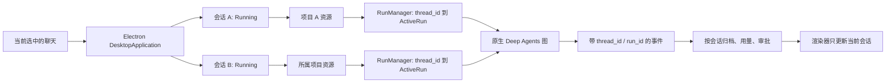

# 数据模型集中与并行会话

2026-10-24：按当前需求直接修改系统，不保留旧模型导入路径或单任务运行分支。数据库表结构、原生 Graph State、工具参数和用户文件保持不变。

## 模型统一入口

所有项目内定义的 Pydantic 模型都在 `packages/agent-harness/src/vertical_harness/models/`，包含直接继承 BaseModel、继承 BaseSettings、继承 Deep Agents 原生 Schema 的模型。每文件一个类，`models/__init__.py` 统一按原名导出：

- `HarnessSettings`、`LangSmithSettings`、`FormatterEntry`
- `FileGlobSchema`、`NativeReadSchema`、`SearchSchema`、`PatchSchema`
- `StreamEvent` 及其 `StreamEventType`

其他模块只使用包入口：

```python
from vertical_harness.models import HarnessSettings, PatchSchema, StreamEvent
```

不使用 `as` 别名，也不保留旧模块转发。所有调用者、CLI、打包校验脚本、测试已迁移。包内模型间的依赖直接引用所属文件，避免通过尚未初始化完成的导出入口形成循环。架构测试约束 BaseModel/BaseSettings 只出现在该包的模型定义中，并约束包外导入方式。

## 并行运行边界



- Python RunManager 按 `thread_id` 保存任务，每个会话只允许一个活跃任务，不同会话并行。取消或删除会话只清理目标会话的图调用和 Shell 作业。
- AgentLoop 按 `(tenant_id, user_id)` 持有各项目的 Runtime、RunManager、SessionService。`configure` 选择该组资源；运行任务捕获自己所属的资源引用。相同资源地址复用连接，切换项目不会关闭其他项目。
- Electron Running 持有固定的 project、thread、DesktopStore。后台事件及终态写回原项目，不能使用当前选中项目的存储；切换后用量仍归属原会话。
- 全应用关闭先等待所有项目任务取消，再回收各资源。AsyncExitStack 确保一个资源关闭失败时仍会关闭其他资源。
- 每个运行拥有独立图、回调和计数器，Deep Agents/LangGraph 继续负责模型循环、并行工具和检查点。没有新增模型调度器或第二套 Agent Loop。

## 界面行为

执行中可以新建/切换聊天、切换或绑定项目、重命名/导出会话、查看文件和用量、进入设置并修改配置。导航的短暂请求状态与当前会话的执行状态分开，运行不会全局禁用按钮。

切回执行中的会话，快照恢复 active_run 的运行阶段、工具和已收到的流式记录；暂停会话恢复自己的审批或问答。侧栏标记“运行中”或“待确认”。后台会话的文本、问题、错误或完成快照不替换当前聊天。

Snapshot.active_run 增加 `phase`（running/question）及可选 `question`。内部 run.accepted 携带 session_id，避免延迟的提交回执更新已切换的聊天。原生工具审批和桌面 JSON-RPC 方法名保持不变。

## 配置与审批恢复

每次启动捕获当时的 HarnessSettings。更新运行配置只影响后续任务，不能把已经暂停的 ask 模式任务变成 full 模式执行。

启动时将非凭据设置通过 `model_dump_json` 存入检查点 metadata 的 `desktop_run_settings` 字符串；恢复先验证运行、租户、用户和全部 interrupt ID，再验证该快照并构建原生图。凭据和自定义端点不进入快照，恢复使用当前可信运行环境提供的凭据。

使用字符串是因为当前 LangGraph `get_checkpoint_metadata` 从 RunnableConfig 复制自定义 metadata 时只保留标量，嵌套字典会被过滤。此行为已检查本机安装源码并以真实 SQLite 中断、关闭、重新配置、重启恢复验证；没有自定义 Checkpointer 或状态格式。

参考：[LangGraph 持久化](https://docs.langchain.com/oss/python/langgraph/persistence)。工作区指令/技能仍是实际文件，显式编辑后可被后续读取观察到，不将用户文件复制进配置快照。

旧暂停任务如果缺少执行设置快照，会明确报错，不默认按新权限执行。升级前应完成或取消旧版暂停任务并备份；不自动删除或改写旧数据库。改变运行中的工作区或数据库资源地址仍会拒绝，以免关闭正在借用的资源。

## 验证

回归覆盖：模型导出与导入边界、真实图同时执行两个会话、目标取消、同会话重复启动拒绝、项目切换复用资源、运行中模型测试、配置快照不含 API Key、配置改变后重启恢复审批、跨项目后台归档/用量、删除会话隔离、前端后台事件过滤、切回会话恢复工具和问题、新建任务和侧栏不受执行状态禁用。

完整输出保存在 `.pytest_cache/sessions-*`。Python 全量测试 556 passed / 10 skipped（71.29s），桌面 112 passed / 1 skipped；Ruff、78 个源文件 mypy、TypeScript、生产构建以及 Electron 开发 URL/本地文件冒烟均通过。跳过项依赖 Bun/固定差分参考、Windows 符号链接权限或真实模型配置；未使用真实付费模型，未执行远端服务负载测试。

同一项目的会话可以操作相同工作区；文件锁和原子写保护一次写入，但不能替用户决定两个任务对同一业务文件的修改顺序。需要互斥的业务操作应在相应工具内明确处理，不能重新加全局 UI/Agent 锁。
