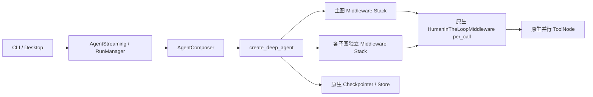
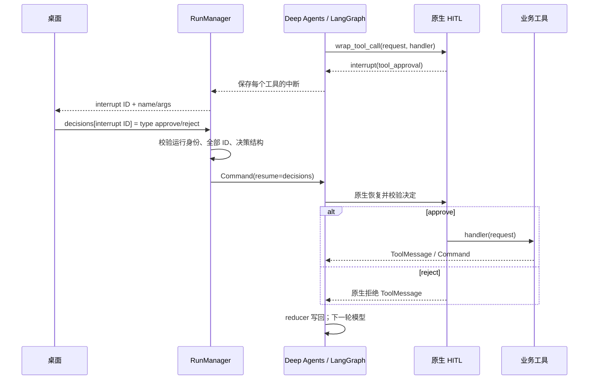

# 原生化优化与当前接口

核验日期：2026-10-24。本轮按用户明确要求移除历史兼容逻辑，直接修改现有项目；不创建第二套 Agent、不增加依赖或调度层。前轮完整审计、架构图、Hook 矩阵及扩展规范见 [Deep Agents 重构报告](DEEP_AGENTS_REFACTOR.md)。本文补充当前契约并取代其中初次审计的兼容策略。

## 真实问题与处理

| 位置 | 原问题 | 本轮处理 | 验证 |
|---|---|---|---|
| `middleware/approval.py`、`core/compose.py` | 自定义逐工具审批重复框架能力，携带历史协议 | 删除整个自定义类；主图和声明式子图分别配置官方 HumanInTheLoopMiddleware per_call | 批准、拒绝、并行混合决策、恢复不重放已完成工具 |
| `runtime/run_manager.py`、桌面 `main/application.ts`、`main/backend.ts` | 桌面依赖 action_requests/decisions 数组，后端类型过宽 | 后端接收原生 tool_approval，按 interrupt ID 提交单个决策；桌面审批与业务问答使用联合类型 | 非法类型、未知决定、缺少或多余 ID、身份不匹配均拒绝 |
| `middleware/directory_instructions.py` | `.name` 为保存旧检查点节点身份而伪装成文件中间件 | 使用 DirectoryInstructionsMiddleware 自然名称 | 主子图每个栈只有一层原生文件与摘要策略，节点名称互不冲突 |
| `project_instructions.py`、`directory_instructions.py`、`model_retry.py`、`execution_limits.py` | 同时读写 harness_* 与 opencode_*，一份状态有两套标记 | 仅使用 harness_instructions / harness_synthetic / harness_stream_retry | 指令去重、步数、流式续写、摘要和重试回归 |
| 各包 `__init__.py` | 传递导出提前导入桌面和整个编排层；运行模块产生 runpy 警告 | 入口只保留包说明；测试、脚本直接导入所属模块 | 独立子进程验证叶子导入不加载宿主、模块启动无重复加载警告 |
| `storage/store.py`、`storage/checkpoint.py` | 裸连接 create_* 与上下文管理 open_* 重复，关闭责任不清 | 删除无生产调用者的 create_*，统一同步/异步上下文管理 | SQLite 初始化失败关闭连接、生命周期和会话测试 |
| `bridge/messages.py`、`utils/usage.py`、`log/logging.py` | 单行透传方法、从未读取的形参和类别名 | 删除 raw_message、usage_estimate 的 model/options 参数、_Formatter 别名 | 所有调用者同步迁移、全包静态检查 |
| 测试配置及 fixture | 传入已经不存在且被忽略的旧功能开关 | 删除 enabled_plugins / enable_memory / enable_skill_gating 和无用 fixture 参数 | 测试只描述当前支持行为 |

没有删除换行/BOM 保留、原子写、敏感路径检查、流式断线保护、取消清理、身份校验或模型特性适配。这些是当前功能和数据安全边界。

## 当前装配与执行

依赖已再次核对 PyPI 正式发布及本机安装：Deep Agents **0.7.32**、LangChain **1.4.7**、LangGraph **1.2.17**；继续使用既有 `uv.lock`。官方逐调用审批是 LangChain 1.4.6 起公开支持的稳定能力，本轮未引入 Beta/Experimental 模块。

依据：[官方 HITL](https://docs.langchain.com/oss/python/langchain/human-in-the-loop)、[Deep Agents 定制](https://docs.langchain.com/oss/python/deepagents/customization)，以及本机 `langchain/agents/middleware/human_in_the_loop.py` 的实现。





模型和工具循环、并行分派、检查点中断及恢复都由框架执行。`after_agent` 仍不保证在异常或取消时执行，资源清理由宿主负责。模型重试不包含工具执行；副作用不自动重试。

## 直接调用契约

```python
from vertical_harness.models import HarnessSettings
from vertical_harness.core.compose import AgentComposer
from vertical_harness.storage.store import StoreFactory

with AgentComposer.open_agent(settings) as graph:
    result = graph.invoke(inputs, config=config)

with StoreFactory.open_store(settings) as store:
    ...
```

`build_agent` 仍是唯一装配入口；新增 Tool 通过 `tools=[...]` 注入，需要审批的工具设置 `metadata={"requires_approval": True}`。子代理自己的 tools 和 middleware 显式声明，不假定主图自定义策略自动继承。文件、Skills、摘要、任务委派继续使用 Deep Agents 原生能力。

工具审批中断的当前形状：

```json
{"id":"interrupt-id","value":{"type":"tool_approval","tool_call_id":"tool-call-id","name":"write_file","args":{"file_path":"/note.txt","content":"text"},"description":"..."}}
```

桌面 JSON-RPC 恢复参数：

```json
{"thread_id":"thread-id","run_id":"run-uuid","decisions":{"interrupt-id":{"type":"approve"}}}
```

每个中断独立批准或拒绝，必须覆盖本轮全部未决 ID。UI 可以逐个收集回答后一次提交；后端直接传给原生 Command。问答工具的 `{kind:"question", question, options}` 是现有业务能力，仍提交非空文本回答；它不是旧审批适配器。渲染器的 `Question.action_requests` 仅用于显示当前单个工具，无后端旧协议解析。

## 升级与数据边界

- 删除根包和子包类重新导出，调用者必须按上面的所属模块路径导入；不提供旧路径转发。
- 删除 `create_store` / `create_checkpointer` / `raw_message`，调用者使用上下文管理器或原生消息 model_dump。
- 不接受旧批量审批 `{"decisions":[...]}` 单中断答案，不识别旧合成消息标记，不保留旧节点别名。
- SQLite 表结构和用户文件不改写、不清空。本次只操作测试临时目录与构建产物，没有迁移生产数据。
- **升级前在旧版本完成或取消暂停任务并备份数据。旧节点/旧审批位置的暂停检查点不能在新图直接继续；新工作使用新线程。** 不承诺对旧合成标记重新解释后的执行语义。
- 外部写完成但 checkpoint 尚未提交的崩溃窗口仍需服务端幂等键或事务 outbox；审批恢复测试不代表跨崩溃 exactly-once。

## 验证结果

完整命令输出保存在 `.pytest_cache/native-cleanup-*`。本轮修改前为 537 passed / 10 skipped；最终回归新增 16 项验证，没有调用真实付费模型。

| 检查 | 结果 |
|---|---|
| 全量 Python pytest | 553 passed、10 skipped（54.97s），见 `.pytest_cache/native-cleanup-full-final.log` |
| Ruff `check .` | 通过 |
| mypy `--no-incremental` | 77 个源文件通过 |
| 桌面 typecheck | 通过 |
| 桌面 Vitest | 106 passed、1 skipped |
| 桌面生产 build | 通过 |
| Electron smoke | 开发 URL 和本地文件两种模式通过 |
| wheel 构建和安装 | 临时独立环境按锁约束安装，源码目录外原生图调用通过 |

Python 跳过项依赖 Bun/固定 OpenCode 差分参考，或 Windows 符号链接权限；它们不是生产运行时的旧框架兼容路径。桌面跳过项是真实模型测试。未执行真实付费 Provider、远程 LangSmith 权限/保留期、远程 CI 或跨进程压测；项目未提供 MCP 客户端或 HTTP/SSE 服务，不能声称有相应集成验证。
