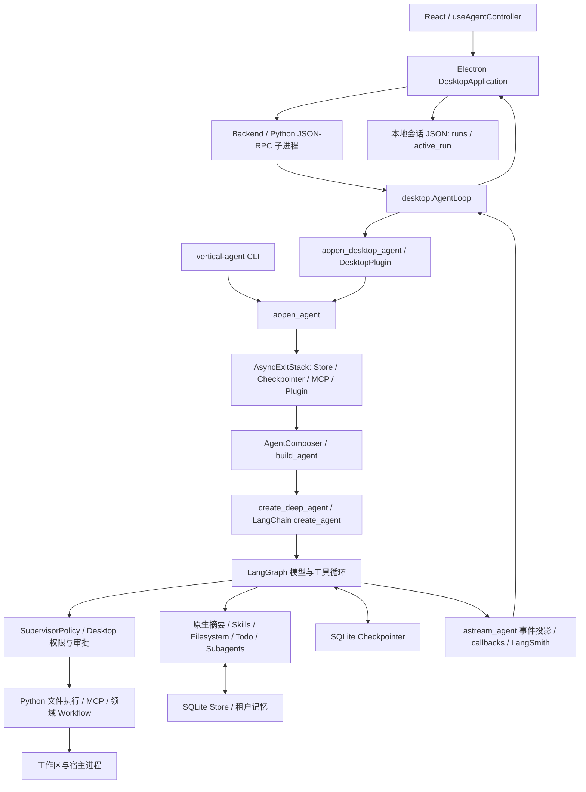

# 当前 Harness 架构审计

审计日期：2026-10-20。对象：`2ca2cca4b0e9974e119353b760a7ff175abf5614` 加审计开始时已有的未提交改动，**不是仅审计 HEAD**。本轮只新增 `docs/harness/` 文档，不改这些运行时代码。后续复现须保留工作树快照；单独 checkout 此 SHA 不会得到相同实现。

审计结束时 HEAD 已由工作区中的其他操作推进为 `311eb388b9bdce64b3babab818558617240f27ee`，原有运行时代码改动已进入提交。本轮未执行 commit；已重新核对 G1 和摘要装配的关键行号仍一致。复现本轮结束状态优先使用此提交及这七份新增文档。

后续实施说明：本文保留该次审计基线及行号；G1 的退出保存与重连结算/审批恢复随后已实施，最新变更和验证见 [upgrade-roadmap.md](upgrade-roadmap.md) 与 [benchmark-plan.md](benchmark-plan.md)。

证据标签：**事实**＝已读取实现；**推断**＝由调用链推出、尚未故障注入；**风险**＝在指定条件下需要验证；**待验证**＝未检查或尚无测量。代码位置均为本轮工作树的一基行号。既有 `docs/HARNESS_REVIEW.md`、`STABILIZATION.md`、`EVALUATION.md` 是历史线索，不替代本轮验证结果。

## 架构与依赖

`packages/agent-harness/pyproject.toml` 声明 Python >=3.11、Deep Agents `>=0.7.28,<0.8`、LangChain `>=1.4.6,<2`、LangGraph `>=1.2.16,<2`。本轮 `.venv` 实际版本分别为 **0.7.28 / 1.4.6 / 1.2.16**，checkpoint-sqlite 3.1.2、LangSmith 0.14.11。声明区间不等于实际版本；后续升级以 `uv.lock` 与干净安装为准。

主要目录职责：

| 目录 | 实际职责 |
|---|---|
| `desktop/src/main/` | 账号/项目/会话、IPC、Python 子进程、附件、运行记录 |
| `desktop/src/renderer/src/` | 对话与事件展示、权限/插件/技能选择、设置 |
| `vertical_harness/config/` | Pydantic Settings、MCP 声明、路径和配置校验 |
| `vertical_harness/engine/` | 装配、策略、模型路由、记忆、事件投影、回放 |
| `vertical_harness/storage/` | Store / Checkpointer 生命周期、文件后端、租户命名空间 |
| `vertical_plugins/common/` | 插件贡献契约、Workflow 图及受管调试接口 |
| `vertical_plugins/data_analysis/` | 领域计算、报告、技能与工作流 |
| `vertical_plugins/research_citation/` | 引文核查领域工作流 |
| `vertical_plugins/web_search/` | 搜索工具插件 |
| `vertical_harness/evaluation/`、`scripts/evaluate_table_demos.py` | 通用评测闭环与桌面多轮回放 |

这些是已追踪的主边界；本轮没有逐行审查全部 UI、所有统计方法或所有第三方实现。

## 入口和关键执行路径

1. CLI：`cli.main` → `_invoke_prompt`（`cli.py:291`）→ `asyncio.timeout` → `aopen_agent` → `agent.ainvoke`。`RunnableConfig` 提供 thread/run/callbacks；`RunContext` 提供可信 tenant/user/task tier。
2. 桌面：Electron `application.ts` → `backend.ts` 的 JSON-RPC → `desktop.AgentLoop.dispatch` → `_run`（`desktop.py:534`）→ `open_configured_agent` → `aopen_desktop_agent` → `aopen_agent` → `astream_agent`。`desktop.py:577` 转交原生图 recursion limit。
3. 装配：`compose.aopen_agent:919` 托管资源 → `build_agent:644` → Composer 注册贡献 → 上传技能并检查结果 → 自定义中间件替换原生同名槽位 → `create_deep_agent` → LangGraph。`build_agent` 返回图，而非另一套自写推理循环。
4. 工具：模型 tool call → 原生工具执行节点与中间件 → Desktop 权限/审批和适用的 SupervisorPolicy → Python/MCP/Workflow → ToolMessage → 下一次模型调用或终止。不是所有普通工具都通过 Workflow 授权网关。
5. 审批恢复：`desktop.py:329–357` 校验 checkpoint 中 run/tenant/user → `Command(resume=...)`；恢复沿用图检查点。Electron `application.ts:412–430` 重建等待审批的运行 UI。
6. 回放/分叉：`engine/time_travel.py` → 原生 checkpoint/history/update_state；跨线程 fork 另复制 checkpoint/pending writes，并限制支持的 namespace/子图。**不回滚 Store 或外部副作用**。

## 十个维度的证据与处置

以下 Python 简写路径以 `packages/agent-harness/src/` 为根。

| 维度 | 现有实现与源码 | 问题、触发条件与证据 | 处置 |
|---|---|---|---|
| Agent Loop | `vertical_harness/engine/compose.py:644–851`；Deep Agents 编译原生图；CLI/streaming 施加总 deadline，图设 step_timeout | 事实：没有产品级固定调用次数上限；`tests/test_model_call_limit.py:16–67` 明确保证可执行 32 次工具调用并继续追问。预算风险仅在需要费用封顶时成立；不能把此测试约定当 bug | 保留原生 Loop；预算须单独定义语义，不能恢复任意固定 30 次硬限 |
| Context Engineering | `compose.py:187–212, 763–783`：按模型 profile 与配置取较小容量，90% 摘要、10% 保留；旧工具参数 8k token 起缩短；Filesystem 工具输出 3k token 起卸载。`engine/policy.py:57–85` 检查最终消息、system、tools 估算 | 已有机制，不缺 compaction。风险：近似计数、动态路由的小窗口、单条大输入、摘要丢失领域事实；本轮没有真实模型摘要保真测量。`tests/test_compose_summarization.py` 提供装配测试，不能证明模型质量 | 保留；增加定向质量/容量测试后再调阈值 |
| Tool Runtime | `python_execution.py:12–69`；`engine/mcp.py:15–87`；`engine/policy.py:1280–1363,1594–1667` | Python 有路径校验、环境筛选、120s 超时、日志与预览；MCP 有 allowlist、host effect 与托管连接。风险：异常逃出 Workflow handler 时，授权完成记录可能跳过；普通业务错误已被转成 failed state，不是所有异常都泄漏 | 保留执行器与注册；先故障注入授权生命周期，不先添加通用重试 |
| State Management | `storage/backends.py:97–283`；`desktop.py:329–357,534–692`；`engine/time_travel.py` | **确认的控制流缺口**：`application.ts:739–742` 后端退出直接清 `running`；`finish:818–841` 才写最终 run；`snapshot:412–430` 仅恢复 interrupt。普通运行崩溃后的 UI 运行记录不能经此路径恢复。未做 SIGKILL 实测 | 保留 Checkpointer；优先修改宿主运行记录结算与重启展示，勿重写图状态 |
| Planning | `compose.py:555–624` 的 `TodoListMiddleware`；`common/workflow.py` 的 `WorkflowPlan` / `WorkflowStep` / 图节点 | 已有模型 Todo 与确定性业务步骤，语义不同。未发现通用自主重规划保证；没有需求证据说明必须另建 planner。触发风险是模型遗漏/错误宣称完成，应由交付验证测量 | 保留两种计划；先用领域验收检查，不引入统一规划器 |
| Subagents | `compose.py:499–517` 注册；WorkflowContribution 转受管子图；SupervisorPolicy allowlist、并发批次/依赖/授权；原生 task 执行隔离/分叉上下文 | 已有委派，不缺子代理。风险：原生消息隔离不代表工作区、凭据、CPU 或进程隔离；动态/编译子图的预算与取消传播需组合测试 | 保留 native task 与 WorkflowContribution；不建另一套 agent scheduler |
| Sandbox | `storage/backends.py:35–55,287` 文件后端；`compose.py:784–830` 文件权限；`python_execution.py:17–22` 明示宿主权限 | **事实边界**：路径限制与环境筛选不是 OS 沙箱；脚本可用当前用户的文件/网络权限。只有部署声称隔离不可信代码时才构成契约缺陷；当前未确认权限绕过漏洞 | 可信本地模式保留；不可信场景需独立执行进程/容器并验证 Windows 支持 |
| Reliability | `engine/streaming.py:201–355` deadline/aclosing/失败后重抛；`common/workflow.py:959–1016` 显式 step retry；MCP/插件 AsyncExitStack | 已有有界执行和局部重试。风险：取消协程不等于撤销外部副作用；检查点与外部服务没有共享事务。崩溃后不能自动重放未知写操作。相关源码比“加重试”更重要 | 保留；先明确失败分类、持久状态和未知结果，再决定每个操作是否可重试 |
| Observability | `engine/streaming.py:243` StreamEvent 含 run/thread/seq/operation/parent；`engine/callbacks.py` 用量完整性；`logging.py`、`observability.py`；offline/online evaluation | 图、桌面 JSON、Store 用量分属不同持久化面，进程退出可破坏运行视图。`completed` 只证明执行产生输出，不能证明任务正确（`evaluation/scoring.py:165–208`） | 保留现有事件和 LangSmith；先补宿主终态及结果质量关联 |
| Extensibility | `plugin_loader.py` entry points/allowlist；`compose.AgentComposer` 冲突校验；`common/contracts.py`；open/aopen；Skills/MCP | 进程内插件是可信 Python，raw Store 不提供不可信插件隔离。当前没有证据支持热卸载、第三套 Hook 总线或容器层的必要性 | 保留现有扩展点；明确 Framework/Harness/领域插件责任 |

## 已验证与未验证

本轮检查结果集中见 [benchmark-plan.md](benchmark-plan.md)。先前文档中的统计方法质量、真实模型成本和测试数不能自动算成本轮结果。生产测试没有固定调用次数上限这一点已由当前测试源码确认；评测脚本 `ConversationBudget` 的 24 次 / 300,000 reported-token 限额只属于该回放脚本。

仍未验证：后端硬杀恢复、真实 MCP/provider 中断、摘要质量、跨租户并发压力、OS 沙箱、真实模型对照收益。缺少证据不等于缺少能力。
