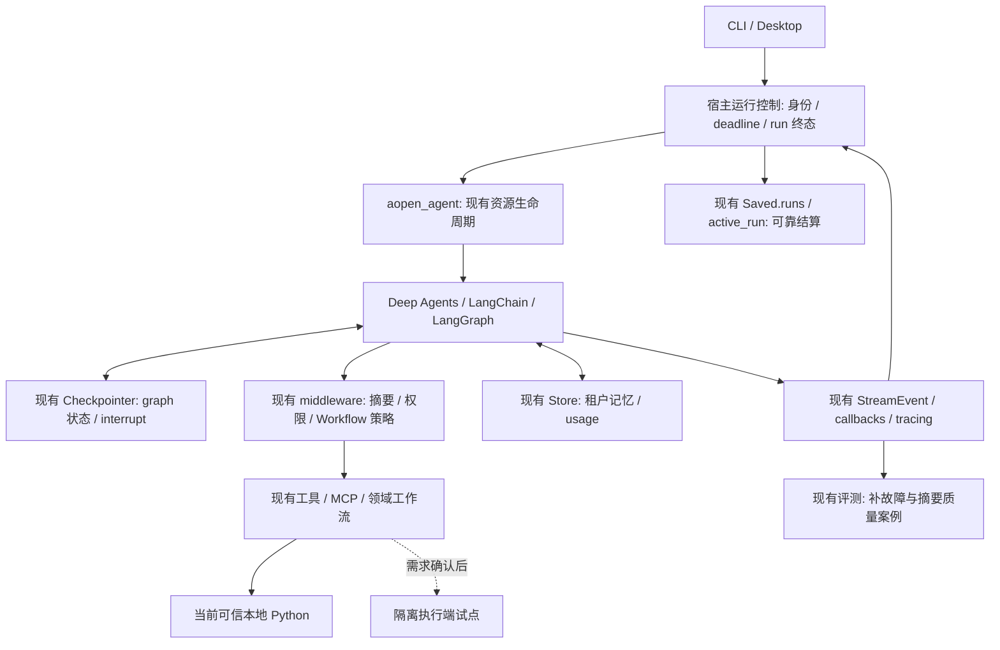
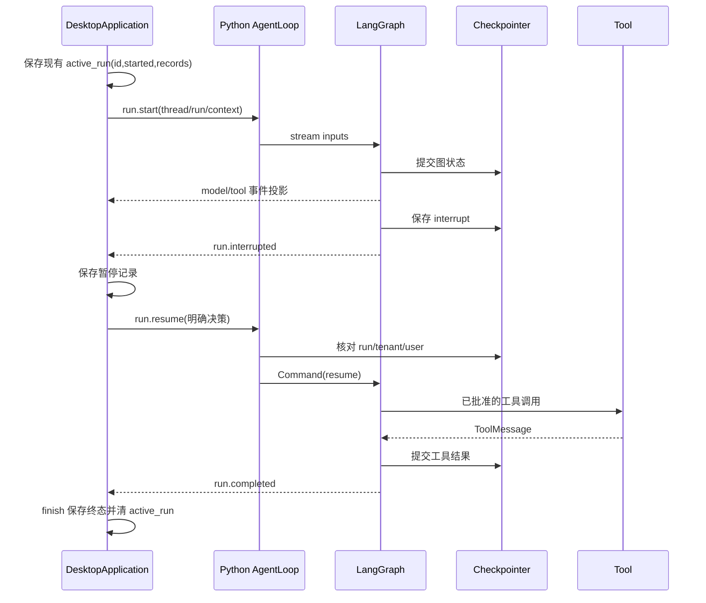
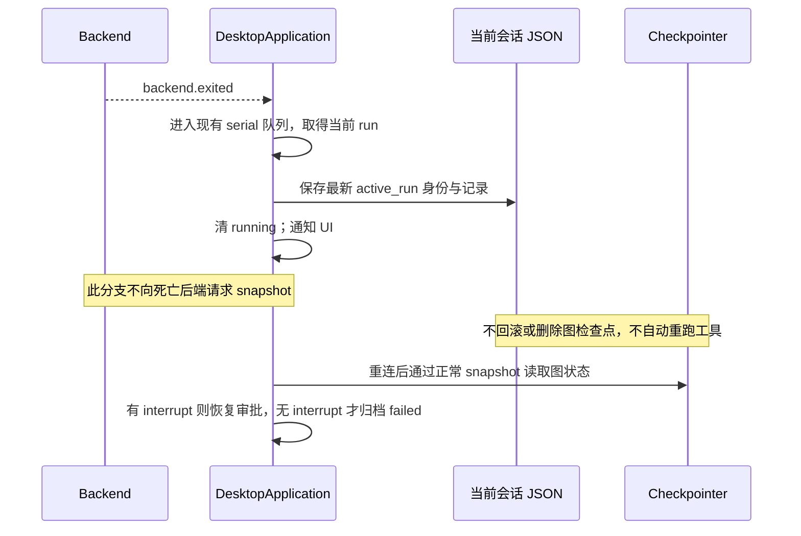

# 目标架构与迁移边界

状态：**G1 的退出保存/重连结算、G2 的 handler 异常授权收尾、G2b 的前置检查通过后启动已实施，其余为方案**。其余组件只有证据通过后才演进。审计时架构见 [current-architecture.md](current-architecture.md)，实施验证见 [benchmark-plan.md](benchmark-plan.md)。

## 目标架构

虚线是候选；实线不代表本轮已修改。没有新增统一事件总线、任务数据库、模型路由容器或另一套 Loop。

## 关键执行时序

正常执行及审批恢复沿现有协议：

G1 候选修复的异常路径：

此时序已通过确定性状态/磁盘恢复检查及真实 bridge 退出通知检查；尚未做真实模型运行中硬杀的端到端验证，不承诺外部工具恰好一次。

## 模块职责、接口与依赖方向

| 责任 | 继续使用的接口 | 允许的最小演进 |
|---|---|---|
| 产品入口/身份 | `AgentLoop.dispatch`、RunContext、Electron IPC/JSON-RPC | 可信宿主继续校验 tenant/user/thread/run；不让模型 payload 自行授权 |
| 构建/资源 | `aopen_agent/open_agent`、BuildServices、DomainPlugin open/aopen | 新执行端资源也由这里托管；不把借用资源关闭 |
| 模型与工具循环 | `create_deep_agent` → `create_agent` 原生图 | 不新增 Loop；通过 middleware/backend/tool 扩展 |
| 图持久化 | `RunnableConfig.configurable.thread_id`、Checkpointer、Command | 保持消息 reducer 和 checkpoint/pending write 语义 |
| 宿主运行记录 | `Saved.runs`、`active_run`、`writeAtomic`、`finish` | 抽出确有复用需要的本地结算步骤，普通完成仍保留 snapshot；崩溃分支用已知数据结算，无需新公共 API |
| 策略/授权 | PluginAuthorizationGateway / SupervisorPolicyMiddleware | 对具体失败结果明确生命周期；保留 GraphBubbleUp；先定契约再改异常处理 |
| 领域任务 | PluginContribution / WorkflowContribution / WorkflowContext | 领域校验、重试与产物检查留在领域层，不挪入核心模型 dispatch |
| 执行结果 | Python 工具现有结果 dict；MCP BaseTool | 保持字段/嵌套和 side-effect 顺序；隔离端将来必须给出兼容结果与持久日志 |
| 观测/评测 | StreamEvent、WorkflowLoggingHandler、offline targets | 复用 operation/parent/run/thread 关联；补失败注入及独立质量断言 |

Framework 负责图、消息协议、原生摘要与工具循环；Harness 负责可信身份、运行与资源生命周期、权限、产品持久化视图及评测；业务插件负责领域输入/计算/验证/报告。依赖保持“应用 → Harness → Framework”，领域通过公共贡献契约接入。

## 新旧迁移映射

| 当前实现 | 目标 | 是否必须修改 |
|---|---|---|
| `application.ts` backend.exited 直接清 running | 保存当前 active_run；重连核对检查点后结算或恢复审批 | **G1 已实施**；定向和桌面全量测试通过 |
| `application.ts` 启动已写 active_run，但重建仅看 interrupt | 当前会话加载时区分暂停与退出遗留记录 | **G1 已实施**；不全盘扫描/回填历史会话 |
| `backend.ts` pending RPC 失败通知 | 保留；测试重复 error/exit 通知 | 通常保留，除非实测发现重复通知破坏结算 |
| `compose.py` 装配、middleware 替换 | 原位保留 | 无证据要求修改 |
| `storage/backends.py` Checkpointer/Store | 原位保留 | 不迁移数据库，不复制整份事件源 |
| `policy.py` handler 后 mark、前置校验提前启动 | handler 异常收尾；授权校验保持，全部派发检查通过才启动 | **G2/G2b 已实施**；无匹配回执仍待单独处理 |
| Python 本地执行器 | 可信模式保留；按需求试点隔离执行端 | **条件修改**，无部署需求则保持 |
| evaluation / table 回放 | 增加明确案例和指标 | 优先补验证，不替换框架 |

## 风险与回滚

G1 以现有 `failed` 状态和 Saved 形状实现为优先方案，避免新增协议枚举/迁移。运行记录缺少的字段不能编造；只使用已有允许的可选字段。若实现需要改变外部接口、特殊异常契约或历史数据兼容，先提出具体差异并遵守仓库的确认规则。

每个机制单独提交；回滚仅撤回该提交，不删除/移动数据库或运行目录。G1 不重放工具、不清 checkpoint。隔离执行端若未来引入，保留当前可信本地路径并通过明确部署选择切换；不做静默 fallback。目标不包含多副本执行租约或分布式恰好一次保证。
