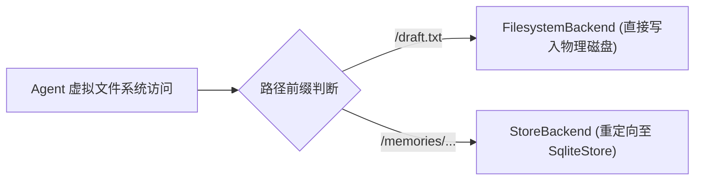

# 状态隔离与分层存储

在复杂 Agent 系统中，不同生命周期的状态必须进行物理与逻辑分离。`vertical-agent-harness` 严格将系统状态划分为短时会话、长期知识库与工作区产物三层，并在 `vertical_harness.storage` 子包（含 [storage/namespace.py](../../packages/agent-harness/src/vertical_harness/storage/namespace.py) 与 [storage/backends.py](../../packages/agent-harness/src/vertical_harness/storage/backends.py)）中依托 LangGraph 原生 `SqliteStore` 与 Deep Agents `CompositeBackend` 实现了透明解耦存储。

## 1. 三类状态分离原则

根据 [docs/ARCHITECTURE.md](../../docs/ARCHITECTURE.md)，系统定义了三种正交的状态生命周期：

1. **短期会话状态 (Thread State / Checkpointer)**：
   - 包含当前会话消息列表、Agent 执行计划、中间状态；
   - 关联具体的 `thread_id`；
   - 演示环境下默认使用 `InMemorySaver`，生产部署需由宿主进程注入持久化 Checkpointer（如 Postgres）。
2. **长期记忆与偏好 (Long-term Store)**：
   - 存储跨线程的项目偏好、经过核准的专业记忆与业务策略；
   - 依托 LangGraph 原生 `BaseStore`（默认提供 `SqliteStore` 与 `AsyncSqliteStore`）；
   - 按 `(tenant_id, user_id, bucket)` 命名空间进行多租户物理与逻辑隔离。
3. **工作区产物与文件证据 (Artifacts / Filesystem)**：
   - 用户手稿、原始输入文件、分析草稿与不可变证据；
   - 存放在由 `FilesystemBackend` 托管的物理工作区磁盘目录中（默认 `./.agent-workspace`）。

## 2. 多租户命名空间清洗与隔离 (`storage/namespace.py`)

LangGraph 原生 `SqliteStore` 在底层使用点号 `.` 作为命名空间分段的拼接分隔符（例如 `ns1.ns2.ns3`）。如果租户 ID 或用户 ID 中包含点号（如 `lab.a`、`user.123`），将导致底层命名空间分段错误解析。

在 [packages/agent-harness/src/vertical_harness/storage/namespace.py](../../packages/agent-harness/src/vertical_harness/storage/namespace.py) 中，系统设计了清洗逻辑：

```python
_UNSAFE_NS_CHARS = re.compile(r"[^A-Za-z0-9\-_@+:~]")

def _sanitize_segment(value: str | None, fallback: str = "default") -> str:
    if not value:
        return fallback
    cleaned = _UNSAFE_NS_CHARS.sub("_", value.strip())
    return cleaned or fallback
```

通过 `tenant_memory_namespace` 函数，系统从 LangGraph 的 `Runtime[RunContext]` 中提取上下文，并输出清洗后的三元组 `(clean_tenant, clean_user, bucket)`，彻底隔绝越权访问与键值污染风险。

## 3. SqliteStore 生命周期管理 (`storage/backends.py`)

[packages/agent-harness/src/vertical_harness/storage/backends.py](../../packages/agent-harness/src/vertical_harness/storage/backends.py) 封装了基于文件的 SQLite 与内存存储生命周期：

- **连接路径预备 (`_prepare_conn_string`)**：基于 `settings.resolved_store_target` 获取目标路径；若为本地文件 `Path`，自动递归创建父目录。
- **直接创建与自动化表初始化 (`create_store`)**：建立连接时指定 `check_same_thread=False` 与 `isolation_level=None`（自动提交模式），实例化 `SqliteStore` 后自动调用 `store.setup()` 创建底层键值表结构与索引。
- **上下文管理器**：
  - 同步接口：`open_store(settings)` 利用 `SqliteStore.from_conn_string` 管理连接并在进入上下文时执行 `store.setup()`。
  - 异步接口：`aopen_store(settings)` 利用 `AsyncSqliteStore.from_conn_string` 提供异步生命周期并执行 `await store.setup()`。
  - 纯内存模式：当配置 `settings.store_backend == StoreBackendType.MEMORY` 时，优雅降级为 `InMemoryStore()`。

## 4. CompositeBackend 虚拟文件系统挂载

为了让大模型使用直观的文件操作工具（如读取 `/memories/AGENTS.md`）而无需学习专有 API，系统通过 `compose_backend` 实现了复合后端挂载：



- **物理工作区映射**：默认路由指向 `FilesystemBackend(root_dir=str(workspace_root), virtual_mode=True)`，文件真实落盘在本地目录。
- **记忆路由重定向**：使用 `PurePosixPath` 规范化虚拟记忆路由前缀（默认 `/memories/`），通过 `StoreBackend(store=store, namespace=namespace_factory)` 拦截并透明转换为对 `SqliteStore` 的键值存取，绝不会在磁盘上创建物理子目录。
- **测试验证**：在 [tests/test_store.py](../../tests/test_store.py) 中针对隔离性进行了回归验证，确认向 `/memories/AGENTS.md` 写入的内容仅存在于 SQLite 数据库内，磁盘上无物理对应文件。

## 相关页面

- [Harness 系统架构与核心组装](./overview.md)：查看 `build_agent` 如何调用 `compose_backend`。
- [环境变量配置与运维部署](../operations/configuration.md)：查看存储后端配置与数据库路径推断规则。
