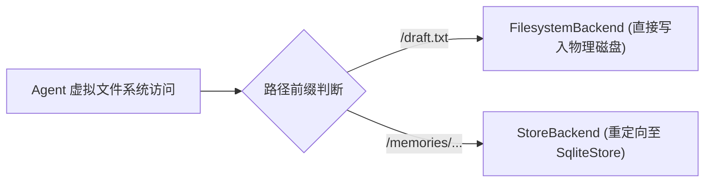

# 状态隔离与分层存储

在复杂 Agent 系统中，不同生命周期的状态必须进行物理与逻辑分离。`vertical-agent-harness` 严格将系统状态划分为短时会话、长期知识库与工作区产物三层，并在 `vertical_harness.storage` 子包（含 [storage/namespace.py](../../packages/agent-harness/src/vertical_harness/storage/namespace.py) 与 [storage/backends.py](../../packages/agent-harness/src/vertical_harness/storage/backends.py)）中依托 LangGraph 原生 `SqliteStore` 与 Deep Agents `CompositeBackend` 实现了透明解耦存储。

## 1. 三类状态分离原则

根据 [docs/ARCHITECTURE.md](../../docs/ARCHITECTURE.md)，系统定义了三种正交的状态生命周期：

1. **短期会话状态 (Thread State / Checkpointer)**：
   - 包含当前会话消息列表、Agent 执行计划、中间状态；
   - 关联具体的 `thread_id`；
   - 本地开发与 CLI 默认使用 SQLite Checkpointer（`SqliteSaver` / `AsyncSqliteSaver`，路径 `<runtime_data_dir>/checkpoints.sqlite`），配合 `durability="sync"` 确保每个节点执行后同步落盘，支持跨进程恢复与 Time Travel 回放；生产部署可注入分布式持久化 Checkpointer（如 Postgres）。
2. **长期记忆与偏好 (Long-term Store)**：
   - 存储跨线程的项目偏好、经过核准的专业记忆与业务策略；
   - 依托 LangGraph 原生 `BaseStore`（默认提供 `SqliteStore` 与 `AsyncSqliteStore`）；
   - 按 `(tenant_id, user_id, bucket)` 命名空间进行多租户物理与逻辑隔离。
3. **工作区产物与文件证据 (Artifacts / Filesystem)**：
   - 用户手稿、原始输入文件、分析草稿与不可变证据；
   - 存放在由 `FilesystemBackend` 托管的物理工作区磁盘目录中（默认 `./.agent-workspace`）。

## 2. 多租户命名空间确定性哈希隔离 (`storage/namespace.py`)

LangGraph 原生 `SqliteStore` 在底层使用点号 `.` 作为命名空间分段的拼接分隔符（例如 `ns1.ns2.ns3`）。为了彻底避免特殊字符破坏底层分隔符或在清洗过程中产生哈希碰撞，系统采用确定性 SHA-256 身份隔离机制：

```python
def _identity_segment(value: str | None) -> str:
    if not isinstance(value, str) or not value.strip():
        raise ValueError("Memory namespaces require nonempty trusted tenant/user/bucket IDs")
    return hashlib.sha256(value.encode("utf-8")).hexdigest()

def tenant_memory_namespace(
    runtime: Runtime[RunContext] | None = None,
    *,
    bucket: str = "memories",
) -> tuple[str, ...]:
    context = getattr(runtime, "context", None) if runtime is not None else None
    return (
        "file_memory_v2",
        _identity_segment(getattr(context, "tenant_id", None)),
        _identity_segment(getattr(context, "user_id", None)),
        _identity_segment(bucket),
    )
```

- **Fail-Fast 强校验**：拒绝空值或全空白字符，杜绝未经授权共享或静默回退到全局默认租户。
- **SHA-256 摘要隔离**：通过 `_identity_segment` 计算 UTF-8 编码的 64 位十六进制 SHA-256 哈希元组，避免命名空间注入攻击与字符污染。
- **显式迁移工具 (`copy_memory_namespace`)**：提供安全的只读扫描与幂等写入迁移工具，在核准所有权后安全将历史条目复制至新命名空间，杜绝覆盖风险。

## 3. SqliteStore 生命周期管理 (`storage/backends.py`)

[packages/agent-harness/src/vertical_harness/storage/backends.py](../../packages/agent-harness/src/vertical_harness/storage/backends.py) 封装了基于文件的 SQLite 与内存存储生命周期：

- **连接路径预备 (`_prepare_conn_string`)**：基于 `settings.resolved_store_target` 获取目标路径；若为本地文件 `Path`，自动递归创建父目录。
- **直接创建与自动化表初始化 (`create_store`)**：建立连接时指定 `check_same_thread=False` 与 `isolation_level=None`（自动提交模式），实例化 `SqliteStore` 后自动调用 `store.setup()` 创建底层键值表结构与索引。
- **上下文管理器**：
  - 同步接口：`open_store(settings)` 利用 `SqliteStore.from_conn_string` 管理连接并在进入上下文时执行 `store.setup()`。
  - 异步接口：`aopen_store(settings)` 利用 `AsyncSqliteStore.from_conn_string` 提供异步生命周期并执行 `await store.setup()`。
  - 纯内存模式：当配置 `settings.store_backend == StoreBackendType.MEMORY` 时，优雅降级为 `InMemoryStore()`。

## 4. CompositeBackend 虚拟文件系统挂载

为了让大模型使用直观的文件操作工具（如读取 `/memories/AGENTS.md`）而无需学习专有 API，系统通过 `compose_backend` 实现了复合后端挂载：



- **物理工作区映射**：默认路由指向 `FilesystemBackend(root_dir=str(workspace_root), virtual_mode=True)`，文件真实落盘在本地目录。
- **记忆路由重定向**：使用 `PurePosixPath` 规范化虚拟记忆路由前缀（默认 `/memories/`），通过 `StoreBackend(store=store, namespace=namespace_factory)` 拦截并透明转换为对 `SqliteStore` 的键值存取，绝不会在磁盘上创建物理子目录。
- **测试验证**：在 [tests/test_store.py](../../tests/test_store.py) 中针对隔离性进行了回归验证，确认向 `/memories/AGENTS.md` 写入的内容仅存在于 SQLite 数据库内，磁盘上无物理对应文件。

## 5. Checkpoint 持久化与 Time Travel Fork (`engine/time_travel.py`)

为支持跨进程会话恢复、确定性调试与分支实验，框架深度集成了 LangGraph Checkpointer 与 Deep Agents 的同步落盘机制：

- **同步持久化 (`durability="sync"`)**：默认启用同步持久化策略，无论是主智能体 Supervisor 还是挂载的 `CompiledSubAgent` 工作流，每一步节点执行完毕后均同步落盘至 SQLite 检查点数据库（`SqliteSaver` / `AsyncSqliteSaver`），避免异步落盘导致的状态滞后或丢失。
- **检查点历史检索与快照**：通过 `get_checkpoint_history(agent, thread_id)` 与 `get_checkpoint_snapshot(agent, thread_id, checkpoint_id)` 检索会话的完整快照链，输出包含 `checkpoint_id`、父检查点、当前活跃节点 `next_nodes` 与更新时间的时间线。
- **Time Travel 原地回放与状态分叉 (`fork_checkpoint` / `time_travel_invoke`)**：
  - **原地回放**：通过指定 `--checkpoint-id` 直接从历史状态恢复执行。
  - **状态注入分叉**：支持注入 `--update-state` 覆盖历史消息或上下文参数，探索不同决策路径。
  - **跨线程分支 (Fork)**：支持通过 `--fork-thread-id` 将历史检查点完整克隆至新线程，新旧线程彼此隔离，互不干扰。
  - **策略一致性保障**：由于 `SupervisorPolicyMiddleware` 直接从当前检查点的 `messages` 历史重建调度次数与状态，执行 Time Travel 回溯或分叉后，工作流监督策略自动与回溯点保持严格一致。

## 相关页面

- [Harness 系统架构与核心组装](./overview.md)：查看 `build_agent` 如何调用 `compose_backend`。
- [环境变量配置与运维部署](../operations/configuration.md)：查看存储后端配置与数据库路径推断规则。
- [MedPeer 桌面前端工作台](../integrations/desktop-workbench.md)：了解桌面工作台的独立本地数据持久化与账户目录结构。
