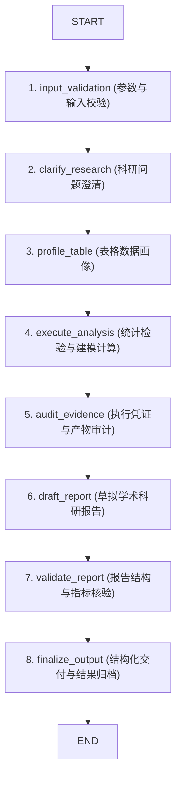

# 科研数据分析插件实现

`vertical-agent-harness` 内置的 `vertical_plugins.data_analysis` 是基于垂直领域插件标准规范实现的科研表格数据分析与学术报告生成插件。该插件随 `vertical-agent-harness` 统一发行，严格遵循插件根目录仅保留唯一 `__init__.py` 的架构约束，通过标准 Python entry points 接入宿主 Harness。

根据 [packages/agent-harness/src/vertical_plugins/data_analysis/__init__.py](../../packages/agent-harness/src/vertical_plugins/data_analysis/__init__.py)，插件划分为高内聚的子模块结构：
- `vertical_plugins.data_analysis.workflow`：基于 `DataAnalysisWorkflow` 类封装的 8 阶段全流程 LangGraph 管道、三层状态契约与工作流贡献工厂。
- `vertical_plugins.data_analysis` 根模块：领域插件入口实现（`DataAnalysisPlugin`）与技能资产加载。
- `vertical_plugins.data_analysis.tools`：原生 LangChain 工具包（`DataAnalysisToolkit`）、DuckDB / OpenPyXL 表格画像与中文科研报告格式核验。
- `vertical_plugins.data_analysis.models`：表格画像（`profile.py`）、报告核验（`report.py`）与执行凭证（`evidence.py`）的 Pydantic 强类型契约模型。
- `vertical_plugins.data_analysis.runtime`：执行凭证采集中间件（`AnalysisEvidence`）、检查点审查与节点 Hook 控制。
- `vertical_plugins.data_analysis.prompts` / `guides` / `skills`：固定节点提示词、科研指导文档与可挂载技能。

## 1. 插件结构与构建贡献 (`__init__.py`)

在 [packages/agent-harness/src/vertical_plugins/data_analysis/__init__.py](../../packages/agent-harness/src/vertical_plugins/data_analysis/__init__.py) 中，`DataAnalysisPlugin` 显式继承 `DomainPlugin` 抽象基类：

- **清单声明 (`PluginManifest`)**：插件标识符为 `data_analysis`，接口版本为 1，语义化版本为 `0.1.0`。
- **技能读取与缓存 (`_load_skill_asset`)**：利用 `importlib.resources.files` 从包内静态资源读取 `scientific-data-analysis/SKILL.md`，构建严格路径约束的 `SkillAsset`。
- **构建贡献装配 (`build`)**：
  - **8 阶段工作流导出**：通过 `build_data_analysis_workflow_contribution(mode=self._workflow_mode)` 导出预编译状态图工作流 `data_analysis_workflow`。
  - **原生分析工具包导出**：实例化 `DataAnalysisToolkit(services.workspace_root)`，通过 `ToolContribution.from_toolkit(toolkit, exposure=Exposure.EAGER)` 直接向主智能体暴露表格画像与报告保存工具。
  - **中间件接入**：注入 `AnalysisEvidence(services.workspace_root)` 执行凭证追踪中间件，记录分析执行链路与产物哈希。
  - **系统指令注入**：向智能体追加 `DATA_ANALYSIS_INSTRUCTIONS`，引导按照科学实验规范进行严谨的数据探索与论证。

## 2. 8 阶段工作流与类封装 (`DataAnalysisWorkflow`)

在 [packages/agent-harness/src/vertical_plugins/data_analysis/workflow/pipeline.py](../../packages/agent-harness/src/vertical_plugins/data_analysis/workflow/pipeline.py) 中，系统设计了 `DataAnalysisWorkflow` 管道类，收敛了状态图定义、静态编译、专用智能体派发与结果交付：

### 2.1 架构与设计约束
- **确定性静态拓扑图**：状态图结构在编译期完全确定，绝非由主智能体动态构建，保证可复现性与确定性。
- **节点内智能体 (`create_node_agent`)**：在需要自由推理或代码生成的特定节点（如统计建模、报告草拟）中，按需调用 `langchain.agents.create_agent` 装配专用子智能体，而不是污染外层图结构。
- **三层状态契约**：
  - `DataAnalysisInputState`（`input_schema`）：接收输入文件路径 `file_path`、研究问题 `research_question` 或兼容消息体。
  - `DataAnalysisInternalState`（`InternalState`）：内部流转各阶段产物（画像数据 `profile`、分析执行日志、报告草稿 `report_draft` 及核验错误清单）。
  - `DataAnalysisOutputState`（`output_schema`）：输出符合标准的结构化科研交付物。

## 3. 表格分析算法与报告核验 (`tools/`)

在 [packages/agent-harness/src/vertical_plugins/data_analysis/tools/](../../packages/agent-harness/src/vertical_plugins/data_analysis/tools/) 中，插件实现了面向科研场景的原生算法：

- **高效表格画像 (`tools/table_profile.py`)**：基于 DuckDB 原生计算引擎分析 CSV、Parquet，结合 OpenPyXL 处理 Excel 文件，秒级完成行数、列类型推断、缺失率统计、分位数与前 N 个高频值采样，生成 `TableProfileResult`。
- **报告规范性核验 (`tools/reports.py`)**：针对中文科研报告强制校验五大核心段落（研究背景、实验方法、分析结果、讨论与发现、局限性说明），并对照执行证据中的统计检验量与 p 值进行数值一致性核验。
- **工具包统一装配 (`tools/toolkit.py`)**：通过 `DataAnalysisToolkit` 统一管理工具的输入模式与异常拦截，保证分析操作的 Fail-Fast。

## 4. 强类型契约模型与执行凭证 (`models/` & `runtime/`)

系统杜绝松散无约束的 Python 字典，所有数据流转基于 Pydantic v2 `StrictModel`：
- `TableProfileInput` 与 `TableProfileResult`：定义输入路径限制与结构化画像字段。
- `ReportValidationInput` 与 `ReportValidationResult`：定义学术报告五大段落模型与校验状态 `issues`/`passed`。
- `ExecutionReceipt`：记录分析过程中生成的文件路径、执行耗时、状态码及 SHA-256 哈希值，确保科研结论的可溯源性。

## 相关页面

- [插件机制与贡献契约](../architecture/plugin-system.md)：了解插件发现与贡献接口标准。
- [学术引用审计插件实现](./citation-plugin.md)：查看学术引用核查插件架构。
- [快速开始与任务导航](../quickstart.md)：了解 Harness 安装与运行环境。
