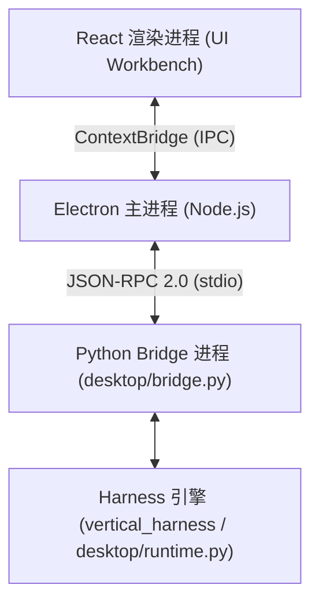

# MedPeer 桌面前端工作台

`desktop/` 目录集成了从 MedPeer 迁移的 Electron/React 桌面工作台，为 `vertical-agent-harness` 提供了开箱即用的可视化交互界面与桌面运行环境。桌面端保持原生前端界面与预加载层不变，通过 Python 子进程桥接（Bridge）对接底层 Harness 引擎。

## 1. 架构总览与分层设计

桌面端采用四层松耦合架构：



1. **React 渲染层 (`src/renderer/`)**：基于 React 构建的工作台界面，包含对话历史流式展示、会话侧栏、附件预览、Token 窗口悬浮窗、工具调用详情卡片（ToolCard）及审批交互面板。
2. **Electron 主进程 (`src/main/`)**：负责窗口生命周期管理、本地数据持久化（`DesktopStore` 与 `LocalStore`）、SSO 登录会话保持与凭据加密。
3. **Python Bridge 进程 (`desktop/bridge.py`)**：通过标准输入输出（`stdio`）以 JSON-RPC 2.0 协议接收前端控制命令（`configure`、`stream`、`interrupt` 等），管理异步流式执行生命周期并实时回传事件帧。
4. **桌面运行时 (`desktop/runtime.py`)**：封装 `DesktopPlugin`，向 Harness 动态注入桌面指令、Skills 技能包及中间件（上下文超限防护、工具权限审批）。

## 2. 安全与凭据隔离

桌面端严格遵循安全隔离规范：

- **SSO 登录与会话隔离**：使用 MedPeer SSO 登录窗口完成身份认证。部署配置位于 `settings.example.json`（或通过环境变量 `MEDPEER_CONFIG_FILE` 指定自定义 `settings.json`）。
- **DPAPI 本地加密存储**：登录凭据由 Electron 主进程调用 Windows 系统底层 DPAPI 加密存储于 `%APPDATA%\agent-harness-desktop\credentials.bin` 中，凭据绝不暴露给前端渲染进程。退出登录时安全擦除凭据。
- **环境变量密钥隔离**：根目录 `.env` 中的 `VA_MODEL`、`VA_API_KEY` 与 `VA_BASE_URL` 仅由 Python 主进程安全读取，不写入前端代码或渲染上下文。

## 3. 数据存储与多账户隔离

桌面工作台的数据统一存放于用户的操作系统应用数据目录中：

```
%APPDATA%\agent-harness-desktop\
├── credentials.bin                     # 加密凭据
└── accounts\
    └── <账号用户ID哈希>\
        ├── preferences\                # 全局偏好、指令与设置
        └── <项目ID>\
            ├── workspace\              # 默认项目工作区目录
            ├── session-store.json      # 会话与 Checkpoint 索引
            └── usage.json              # 本地 Token 用量统计
```

- **独立项目与工作区**：每个项目拥有独立的工作目录与存储空间，支持关联外部已有物理目录。
- **会话持久化与恢复**：支持会话搜索、重命名、历史回溯、导出及删除。
- **用量统计**：基于底层大模型返回的 Token 元数据统计输入/输出用量，杜绝虚构未定价的费用。

## 4. 附件解析与多模态上下文预算 (`desktop/attachment_content.py`)

桌面端提供了跨格式的本地附件提取引擎：

- **支持格式**：
  - 纯文本与结构化：`.txt`、`.md`、`.json`；
  - 表格数据：`.csv`、`.tsv`、`.xlsx`（利用 `pandas` 提取前 100 行预览，附带超限提示）；
  - 手稿与文档：`.pdf`（基于 `pypdf` 提取分页正文）、`.docx`（基于 `python-docx` 提取段落与表格）；
  - 图像多模态：`.png`、`.jpg`、`.jpeg`、`.webp`、`.gif`（Base64 编码为 `image_url` 块直接送入多模态模型）。
- **上下文预算防护 (`body_budget`)**：为防止长文件撑爆大模型上下文窗口，所有提取的文本总预算严格限制在 20,000 字符内；超出部分自动截断并追加 `[Attachment context truncated at 20,000 characters.]` 提示。

## 5. 桌面插件与中间件契约 (`desktop/runtime.py`)

在 `desktop/runtime.py` 中，通过动态 `DesktopPlugin` 实现与 Harness 体系的无缝契约对接：

- **`ContextLimitMiddleware`**：在每次模型请求前估算文本 Token 规模，若超出 `max_context_tokens` 阈值则主动拦截并提示清理会话。
- **`DesktopPermissionMiddleware` 与 `DesktopApprovalMiddleware`**：支持 `ask` 权限模式，遇到写操作或外部副作用工具时触发 LangGraph `interrupt`，挂起任务并将审批卡片推送至 React 前端由用户点击批准或拒绝。

## 6. 启动与自动化验证

### 6.1 运行启动

在确保根目录 `.venv` 安装完成后，安装桌面专属依赖：

```powershell
uv pip install --python .venv\Scripts\python.exe -r desktop\requirements.txt
```

启动桌面工作台：
- 双击根目录 `start-desktop.bat`；
- 或在 `desktop/` 目录下执行：
  ```powershell
  npm ci
  npm run dev
  ```

### 6.2 自动化测试套件

桌面端包含完整的质量验收脚本（详见 [desktop/TESTING.md](../../desktop/TESTING.md)）：

```powershell
# 1. 静态类型检查与单测
npm run typecheck
npm test

# 2. 构建与 Electron 冒烟测试
npm run build
npm run test:smoke

# 3. 与原版 UI 渲染一致性核对
node scripts/check-renderer-parity.mjs D:\project\medpeer_agent_cli\desktop

# 4. Python 桌面端测试
..\.venv\Scripts\python.exe -m pytest tests -q
```

## 相关页面

- [快速开始与任务导航](../quickstart.md)：查看桌面端快速安装与一键启动。
- [Harness 系统架构与核心组装](../architecture/overview.md)：了解桌面运行时与底层 AgentComposer 的组合关系。
- [环境变量配置与运维部署](../operations/configuration.md)：查看桌面端模型端点与凭据配置。
