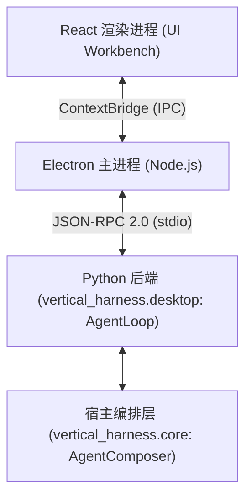

# MedPeer 桌面前端工作台

`desktop/` 目录集成了基于 Electron 与 React 构建的可视化工作台，为 `vertical-agent-harness` 提供了开箱即用的前端交互界面。通过标准输入输出（`stdio`）采用 JSON-RPC 2.0 协议与 Python 后端 [`vertical_harness.desktop`](../../packages/agent-harness/src/vertical_harness/desktop.py) 进行通信。

## 1. 架构总览与分层设计

桌面端采用清晰的分层解耦设计：



1. **React 渲染层 (`src/renderer/`)**：基于 React 构建的工作台界面，包含对话历史流式展示、会话侧栏、附件预览、Token 窗口悬浮窗、工具调用卡片及人机审批面板。
2. **Electron 主进程 (`src/main/`)**：负责窗口生命周期管理、本地数据持久化（`desktop-store.ts` 与 `local-store.ts`）、以及拉起 Python 解释器运行 `vertical_harness.desktop`。
3. **Python 桌面后端 (`vertical_harness/desktop.py`)**：核心类 `AgentLoop` 负责处理 JSON-RPC 2.0 请求（`configure`、`stream`、`interrupt_reply`、`cancel` 等），管理执行图异步流式生命周期，并通过 `DesktopMessages` 实时回传事件。
4. **桌面桥接层 (`vertical_harness/bridge/`)**：
   - `AttachmentContent`：多模态附件解析与内容块构造。
   - `DesktopMessages`：标准化打包 JSON-RPC 消息载荷。
   - `DesktopRuntime`：桌面环境配置探测与工作区根目录初始化。

## 2. 本地数据与项目存储

桌面端采用纯本地存储架构，无需远程账号登录，启动即可直接使用：

```
%APPDATA%\agent-harness-desktop\
├── index.json                          # 项目索引与元数据
├── global\                             # 机器全局偏好、主题设置与审批历史
└── projects\
    └── <项目ID>\
        ├── checkpoints.sqlite          # 对话 Checkpoint 持久化
        ├── store.sqlite                # 键值状态持久化
        └── workspace\                  # 项目默认工作区物理目录
```

- **独立项目与工作区**：每个项目拥有独立的工作目录与存储空间，支持直接关联本地已有目录。
- **会话持久化与回放**：基于 SQLite 检查点实现会话中断恢复、状态回溯与历史导出。
- **用量与成本核算**：基于底层大模型返回的 Token 真实元数据统计用量，避免虚构未定价的调用成本。

## 3. 附件处理与多模态消息构造 (`bridge/attachments.py`)

桌面端提供了跨格式的附件提取引擎：

- **图像多模态**：`.png`、`.jpg`、`.jpeg`、`.webp`、`.gif` 文件自动提取并转换为 Base64 编码的 `image_url` 消息块送入支持多模态的大模型。
- **表格与结构化数据**：`.csv`、`.parquet`、`.xlsx` 文件自动映射为工作区虚拟路径，并引导智能体编写受控 Python 脚本（`execute_python_file`）进行聚合分析，避免大表格文本撑爆上下文窗口。
- **文档与文本文件**：Office 与 PDF 文件通过 `AttachmentContent.extract_text` 基于 MarkItDown 提取结构化 Markdown，或引导智能体通过 `read_file(offset=0, limit=40)` 进行分页读取。

## 4. 人工审批拦截与交互循环

在 `ask` 权限模式下：
1. 智能体发起文件写入或受控脚本执行等副作用工具时，`DesktopApprovalMiddleware` 触发 LangGraph 中断（`__interrupt__`）。
2. `AgentLoop` 捕获中断事件，通过 `DesktopMessages` 向前端发送审批请求事件帧。
3. 渲染层弹出审批确认卡片，用户点击批准或拒绝后，前端发送 `interrupt_reply` 指令。
4. `AgentLoop` 借助 `Command(resume=decision)` 恢复执行图，完成人机协同闭环。

## 5. 启动与验证

### 5.1 运行启动
在根目录安装好 `.venv` 依赖后，开发环境运行：

```powershell
cd desktop
npm ci
npm run dev
```

### 5.2 前端自动化验证
在 `desktop/` 目录下执行：
- 类型检查：`npm run typecheck`
- 前端测试：`npm test`
- 打包构建：`npm run build`

## 相关页面

- [Harness 系统架构与核心组装](../architecture/overview.md)：了解整体中间件链与 Agent 编译流程。
- [快速入门指南](../quickstart.md)：了解命令行与环境配置。
- [测试体系与质量验证](../testing/test-suite.md)：查看完整的自动化测试规范。
