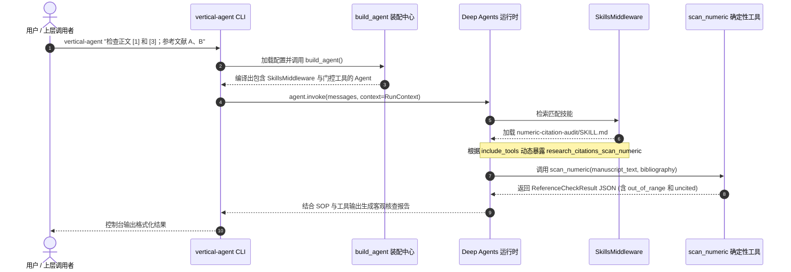

# 数字引用审计端到端流程

本页面详细梳理 `vertical-agent-harness` 中由 `vertical-plugin-research-citation` 驱动的数字引用核查全生命周期。该流程生动展示了技能按需加载（Progressive Skills）、门控工具动态暴露与证据优先报告的协同运作机制。

## 1. 端到端执行时序

从用户在终端发起任务到获得最终核查结果，完整交互链路如下：



## 2. 各阶段关键机制分解

### 2.1 启动与运行时上下文注入
在 [packages/agent-harness/src/vertical_harness/cli.py](../../packages/agent-harness/src/vertical_harness/cli.py) 中：
- 用户输入通过命令行参数传入。
- 系统使用 `open_store(settings)` 打开持久化存储，并调用 `build_agent`。
- 执行 `agent.invoke` 时，通过 `context` 注入 `RunContext(tenant_id=..., user_id=..., task_tier=...)`，保证多租户和模型路由策略的上下文对齐。

### 2.2 提示词引导与技能激活
- 插件的 `PluginContribution` 注入了系统指令：`"Use numeric-citation-audit skill for bracket-numbered references. Report only verified inconsistencies."`。
- 大模型根据系统提示词引导，识别出需要处理方括号数字引用。
- `SkillsMiddleware` 拦截并感知到虚拟 `/skills/` 目录下的技能文档 [packages/research-citation/src/research_citation/skills/numeric-citation-audit/SKILL.md](../../packages/research-citation/src/research_citation/skills/numeric-citation-audit/SKILL.md)。

### 2.3 门控工具按需暴露 (`include_tools`)
- 在 `numeric-citation-audit/SKILL.md` 的 YAML frontmatter 中明确声明了：
  ```yaml
  metadata:
    include_tools: research_citations_scan_numeric
  ```
- `SkillsMiddleware` 读取该元数据后，将初始隐藏的 `research_citations_scan_numeric` 工具动态注入至当前轮次大模型的工具可见列表中，实现了工具的**渐进式暴露**，避免无用工具干扰模型注意力。

### 2.4 确定性算法核查与输出边界
- 大模型调用 `scan_numeric`，传入拆解后的正文纯文本与参考文献列表。
- 工具内部执行严格的正则表达式解析与边界检查：
  - 提取正文中所有引用的数字标号（如 `[1]` 与 `[3]`）。
  - 针对超出文献列表总数的引用标记 `out_of_range`（如索引 3 超出长度 2）。
  - 针对列表中存在但在正文中未被引用的条目标记 `uncited`（如索引 2 未被引用）。
- 工具返回 `ReferenceCheckResult` JSON 序列化字符串，附带明确的作用域声明：`verified_scope = "Numeric reference indexes only; not evidence or semantic validity"`。

### 2.5 最终报告生成
根据 `SKILL.md` 中规定的操作流程（SOP）：
1. 明确区分已确认的引用标号错误与论文语义层面的真实性。
2. 仅列出问题索引与可操作的修改清单，**严禁凭空断言学术造假或违规**。
3. 若输入为作者-年份引用（Author-Date），主动说明本数字核查工具不适用。

## 相关页面

- [快速开始与任务导航](../quickstart.md)：查看完整的安装与 CLI 运行指令。
- [学术引用审计插件实现](../integrations/citation-plugin.md)：查看 `scan_numeric` 与数据模式的源码实现。
- [测试架构与质量保证](../testing/test-suite.md)：查看针对引用核查工具的单元测试。
